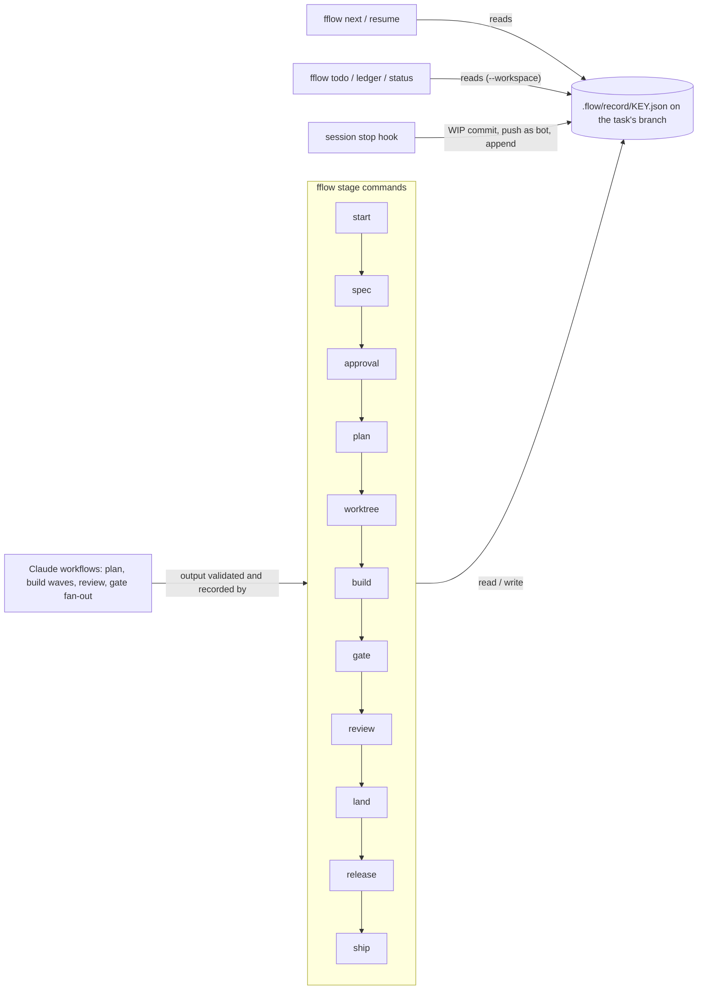
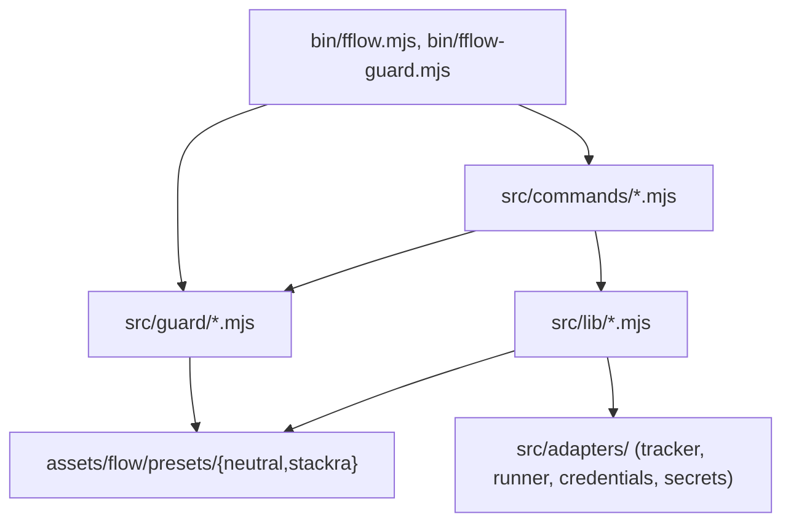
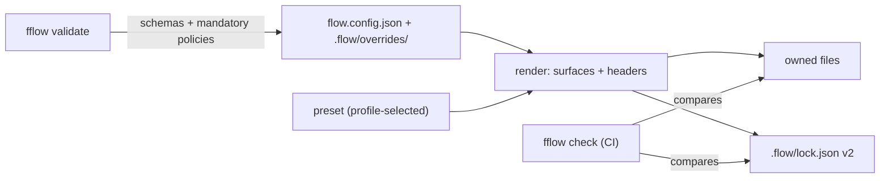

# Implementation Plan: fflow owns every repository's agent and tool setup, under a governed preset

**Spec**: `.agents/specs/sta-1945-flow-owns-everything/spec.md` · **Linear**: STA-1945, STA-2038 · **Date**:
2026-11-02, brought to the design standard 2026-11-03

**Input**: the spec with the owner's decisions D1 to D6 and amendments A-1 to A-3 (approved 2026-11-03). Paths below
are relative to `packages/figentra-flow/` unless they start at the repository root (`docs/`, `.changeset/`) or name
another repository.

## Summary

Build 0.3.0 as 20 Flow PRs in the waves of `path-to-100.md`, governance first: the lock, `check`, `diff`,
`validate`, `update` and `--workspace` come before any new surface, so every surface that follows is born locked and
checkable; Flow's record and the evidence-carrying task markers come with them, so every later PR runs through Flow.
Then the document rules, the rendered setup (guard, surfaces, core's content, third-party skills), the manual glue
(stacks, queues, testbed hooks, the baseline-aware merge bot), Claude inside the stages, the CLI on the console
engine, and the divergence report with the docs. The minor release waits for the last PR. Then comes the migration
(FR-10 steps 2 to 4), one PR per repository, core first.

## Technical Context

- **Language**: plain ESM JavaScript with JSDoc, checked by `tsc` (`checkJs`); Node 24; no runtime dependency (the
  YAML that overrides and preset data need is read by `src/lib/yaml.mjs`, which exists for the agent roster).
- **Members**: `packages/figentra-flow` (`@figentra-oss/flow`) only; Flow's ADRs in `docs/adr/`.
- **Testing**: `node:test` in `src/__tests__/*.test.mjs` (the guard's too), on fixture
  repositories in temporary folders (`src/__tests__/__fixtures__/repo.mjs`); no network. On the Mac only oxfmt and
  oxlint run; typecheck and tests run on the testbed and in CI.
- **What exists**:
  - `src/lib/render.mjs` renders the `flow-*` skills, agents, rules, README, the approval and baseline workflows and
    CODEOWNERS; `writeRendered` writes `.flow/lock.json` (`version`, `preset`, `files`); `installProblems` is
    `gate ci`'s drift check;
  - `.flow/overrides/` holds whole-file replacements of a command or template, keyed by file name
    (`resolveTemplate` in `src/lib/flow-dir.mjs`);
  - `fflow guard` (`src/commands/guard.mjs`) covers only the worktree rule; `land --stack` (`landStack`) lands a
    stack bottom-up; `gate baseline` compares against main's baseline (STA-1942).
- **Content to move** (core `origin/main`):
  - the guard engine: `.agents/hooks/`, 9 modules plus 6 test files, wired by `.claude/settings.json`
    (UserPromptSubmit, SessionStart, two PreToolUse and one PostToolUse entries);
  - 28 role agents, 48 skills (481 files), 15 rules, 29 reference docs, `routing.yaml` and `models.yaml`;
  - `opencode.jsonc` with `.opencode/`, `.mcp.yaml`, `lefthook.yml`, AGENTS.md and CLAUDE.md.

## Key trade-off and research

- **Trade-off: one package carries every preset's content, versioned with Flow.** The preset version is Flow's
  version, so one `pnpm` bump moves both and the lock pins one digest. The cost is tarball size (481 skill files,
  D2); PR 6 measures it, and the fallback (registry `skill` items) is the owner's decision.
- **Trade-off: the guard's rule tables stay JavaScript modules** in the preset
  (`assets/flow/presets/stackra/guard/*.mjs`) rather than YAML: core's `_rules.mjs` holds regular expressions and
  matcher functions, and a format change would break the parity AC-9 demands. The engine stays neutral and reads the
  tables it is given.
- **Trade-off: the record lives on the task's branch** (D6 Q6): no central store and no service; `--workspace` reads
  every repository's records, from branches while open and from the default branch after `land`.
- **Research.** Core's `.agents/hooks/` (the guard to port), `tools/scripts/adr-reserve.mjs` (reservation by a PR
  whose loser conflicts; FR-17 replaces the conflict with a lock), Vellum (tag `legacy-2026-10-30`: markers that
  commands move, waves, evidence, the template depth A-3 takes), the 0.2.3 gate (`checkStage`, `checkTasks`,
  `parseTasks`), and the owner's three CLI try-outs (the after-freeze backlog).

## Applicable standards

| Rule                                                | How it is enforced                                                              |
| --------------------------------------------------- | ------------------------------------------------------------------------------- |
| No runtime dependency (NFR-1)                       | check: `package.json` `dependencies` stays empty (`src/__tests__/e2e.test.mjs`) |
| Tests beside the code in `__tests__/` (ADR 0022)    | check: repository layout in CI                                                  |
| Owned files never hand-edited                       | check: `fflow check` and `gate ci` (`installProblems`)                          |
| Overrides are owner-only paths                      | check: CODEOWNERS rendered from `owner-only.mjs`; the approval workflow         |
| Mandatory policies cannot be switched off (FR-5)    | check: `fflow validate` in CI                                                   |
| Guard behaviour parity with core                    | check: the ported tests and the differential test (AC-9)                        |
| Secrets by name only (ADR 0173)                     | review: findings by the security reviewer; check: gitleaks in CI                |
| Agent network git goes through the bot (ADR 0293)   | check: the guard; review for new code paths that push                           |
| Production waits on the owner's approval (ADR 0468) | check: the GitHub Environment on the Release workflow                           |
| Conventional commits with `Refs:`                   | check: commitlint in lefthook and the Quality Gate                              |
| Every FR and AC traced to a task and a test         | check: `fflow gate tasks` and `fflow trace ci`                                  |

## Constitution Check

| Law                       | Result | Note                                                                                              |
| ------------------------- | ------ | ------------------------------------------------------------------------------------------------- |
| Secrets (ADR 0009)        | PASS   | Flow reads none; `.mcp.yaml` and the guard's tables carry secret names only                       |
| Security                  | PASS   | the guard's rules become mandatory policies; overrides are owner-only paths; `check` fails closed |
| Not built yet (ADR 0011)  | PASS   | no skill-publish pipeline (D2); `sync --workspace` opening PRs stays out ("Not now")              |
| Test placement (ADR 0022) | PASS   | `src/__tests__/`; core's guard tests are ported there                                             |
| Versions and catalogs     | PASS   | no dependency; third-party skills are pinned by digest, not installed as packages                 |
| Licences                  | PASS   | per D1, nothing proprietary or unlicensed is redistributed                                        |

## Deploy modes

| Mode       | Behaviour                                                                                                |
| ---------- | -------------------------------------------------------------------------------------------------------- |
| SaaS       | same everywhere: a developer tool on a developer machine, the testbed and CI; nothing is hosted          |
| On-prem    | same; a repository points `runner` at its own boxes and its tracker adapter at its own tracker           |
| Air-gapped | same, except third-party skill installs need their sources mirrored; the presets ship inside the package |

## Correctness properties

- **P-001**: `check`, `diff` and `validate` never write; `check` exits non-zero exactly when a cause exists — Validates: FR-1
- **P-002**: only `update` changes the preset recorded in the lock; `sync` refuses a preset whose digest differs — Validates: FR-1, FR-2
- **P-003**: `--workspace` gives, per repository, the result of the command run in that repository alone — Validates: FR-1
- **P-004**: the same preset or overrides content gives the same digest on every machine (paths sorted, LF) — Validates: FR-2
- **P-005**: any byte change to an owned file is reported by `check`, header or no header — Validates: FR-3
- **P-006**: every comment-capable owned file starts with the header; strict JSON carries none — Validates: FR-3
- **P-007**: each override kind changes only its target; review dates warn at 14 days and fail after — Validates: FR-4
- **P-008**: `validate` accepts an override set only if every mandatory policy keeps every preset rule — Validates: FR-5
- **P-009**: the rendered set is exactly the profile's selection, and the lock records that profile — Validates: FR-6
- **P-010**: outputs are the preset's plus the config's; dropped owned files go; `.agents/specs/` is untouched — Validates: FR-7, FR-12
- **P-011**: lefthook runs mise first, `pnpm exec` only without mise, exit 2 passes; `mise.toml` pins match the catalog — Validates: FR-7
- **P-012**: for every input of the ported corpus the engine with the stackra tables decides as core's tests expect — Validates: FR-7, FR-11
- **P-013**: a skill installs only with an allowed licence; a `machine-only` one is never installed or recorded — Validates: FR-8
- **P-014**: the divergence report lists exactly the lag, overrides by kind, replacements and disables, and drift — Validates: FR-9
- **P-015**: after each migration step core's checks are green and the replaced copies are gone — Validates: FR-10
- **P-016**: every FR-11 item has a test carrying `@covers sta-1945:` ids — Validates: FR-11
- **P-017**: `next` names one stage and command for any record; `resume` from a half-done stage reaches its end state — Validates: FR-13
- **P-018**: every side door of FR-13 is denied with the Flow command that replaces it — Validates: FR-13
- **P-019**: after any stage end or session stop the record and the work are on the remote — Validates: FR-14, FR-19
- **P-020**: `plan`'s output is accepted only when `gate tasks` is clean, every FR and AC covered, budgets held — Validates: FR-15
- **P-021**: a confirmed blocking finding blocks `land`; the gate fan-out's one status is the AND of its shards — Validates: FR-15
- **P-022**: the merge-up resolves only parent-identical conflicts and never force-pushes — Validates: FR-16
- **P-023**: concurrent reservations get distinct numbers, each on the default branch before it is returned — Validates: FR-17
- **P-024**: every commit the gate accepts carries local hooks' or a testbed run's `Hooks-Run:` trailer — Validates: FR-18
- **P-025**: a session is shown by name, state, worktree and stage; a name off the pattern is flagged — Validates: FR-20
- **P-026**: `todo` and `ledger` are functions of Flow's records only — Validates: FR-21
- **P-027**: `land` merges iff the PR adds no failure against the baseline; newly reached is not a regression — Validates: FR-22
- **P-028**: `[x]` comes only from `task done` at exit 0 on a clean HEAD; a changed document resets its started tasks — Validates: FR-23
- **P-029**: no two tasks of a wave share a path; at most 5 run at once; a failed wave stops at its boundary — Validates: FR-24
- **P-030**: an optional task may stay `[ ]` at Done and is reported; no later wave starts before a checkpoint — Validates: FR-25
- **P-031**: both presets' templates carry every section A-3 names, for each tier — Validates: FR-26, FR-27
- **P-032**: the gate refuses missing Sources, component trees or interfaces, placeholders and open questions — Validates: FR-26, FR-27, FR-28
- **P-033**: a listed vague term fails a big spec and warns on the others — Validates: FR-29
- **P-034**: scope drift, contract drift and an edited approved section are each reported — Validates: FR-30
- **P-035**: every command's output is the same data as tables, plain text and `--json`; `--help` never runs a command — Validates: FR-31
- **P-036**: `release` dispatches the publish only after the owner's Environment approval — Validates: FR-13

## Architecture overview

Flow is one package. Commands (`src/commands/`) call libraries (`src/lib/`, `src/guard/`), which read the presets
(`assets/flow/presets/`) and the repository; nothing in `src/lib/` imports a command. The lifecycle runs as stage
commands that each read and write the task's record; the Claude workflows run inside a session and hand their output
back to a stage command, which validates and records it (D6 Q5).



Dependency direction (arrows point at what is imported):



`fflow sync` and the governance commands:



Where order and failure timing matter, the queue reservation (FR-17):

```mermaid
sequenceDiagram
  participant S as session
  participant F as fflow adr reserve
  participant G as GitHub (as the bot)
  S->>F: reserve SLUG --issue KEY
  F->>G: create ref refs/heads/flow/queue/adr (fails if held)
  alt held and younger than 15 min
    F-->>S: wait and retry (no number yet)
  end
  F->>G: read the numbers file on the default branch; commit +1 on a branch; open a PR
  F->>G: land the PR (fflow land, gate green)
  F->>G: delete the queue ref
  F-->>S: the number (now on the default branch)
```

## Components and responsibilities

One component per build-order PR (the PR number in brackets). Each names its responsibility, location, the files it
adds or changes, its interfaces (JSDoc'd ESM, as the repository writes them), behaviour and failure modes. Tests sit
in `src/__tests__/<subject>.test.mjs` unless stated.

### C1 Governance core [PR 1]

**Responsibility**: lock v2, provenance headers, `check`, `diff`, `validate`, `update`, the locked-preset refusal in
`sync`, and `--workspace` for all five. **Location**: `src/lib/`, `src/commands/`.

```text
packages/figentra-flow/
├── bin/fflow.mjs                    (changed: COMMANDS gains check, diff, validate, update)
├── src/lib/lock.mjs                 (new)
├── src/lib/provenance.mjs           (new)
├── src/lib/workspace-run.mjs        (new)
├── src/lib/render.mjs               (changed: writeRendered writes v2 and headers; installProblems reads v1 and v2)
├── src/commands/check.mjs           (new)
├── src/commands/diff.mjs            (new)
├── src/commands/validate.mjs        (new)
├── src/commands/update.mjs          (new)
├── src/commands/sync.mjs            (changed: refuses a preset digest that differs from the lock)
└── src/__tests__/{lock,provenance,workspace-run,check,diff,validate,update,sync}.test.mjs (new)
```

```js
// src/lib/lock.mjs
/** @typedef {{ source: string, version: string, licence: string, digest: string }} SkillPin */
/** @typedef {{ lockVersion: 2, flow: string, preset: { name: string, version: string, digest: string },
 *   profile: string, overrides: string, files: Record<string, string>, skills: Record<string, SkillPin> }} Lock */
export class LockError extends Error {}
/** @param {string} root @returns {Lock | undefined} undefined without a lock; a v1 lock comes back upgraded. @throws {LockError} on invalid JSON */
export function readLock(root) {}
/** @param {string} root @param {Lock} lock */
export function writeLock(root, lock) {}
/** sha256 over every file under `dir`, paths sorted, CRLF normalised to LF. @param {string} dir @returns {string} */
export function treeDigest(dir) {}
/** @param {string} root @returns {string} the digest of `.flow/overrides/`, "" when absent */
export function overridesDigest(root) {}
/** @param {{ version?: string, preset?: string, files?: Record<string, string> }} v1 @returns {Lock} */
export function upgradeLock(v1) {}
/** @param {string} root @param {Lock} lock @returns {{ path: string, kind: "changed" | "missing" }[]} */
export function driftOf(root, lock) {}

// src/lib/provenance.mjs
/** @typedef {{ preset: string, version: string, override?: string }} Provenance */
/** @param {string} path @returns {"#" | "//" | "html" | "frontmatter" | undefined} undefined for strict JSON */
export function commentStyle(path) {}
/** @param {string} path @param {string} text @param {Provenance} meta @returns {string} */
export function withHeader(path, text, meta) {}

// src/lib/workspace-run.mjs
/** @param {string} dir @param {(root: string) => Promise<{ code: number, line: string }>} fn @returns {Promise<number>} the worst exit code */
export async function eachRepo(dir, fn) {}

// src/commands/{check,diff,validate,update}.mjs: each also exports `run(args): Promise<number>`
/** @param {string} root @param {{ now?: Date }} [options] @returns {{ problems: string[], warnings: string[] }} */
export function check(root, options) {}
/** @param {string} root @param {{ update?: boolean }} [options] @returns {{ path: string, kind: "add" | "change" | "delete", patch: string }[]} */
export function diff(root, options) {}
/** @param {string} root @returns {{ problems: string[], warnings: string[] }} */
export function validateRepo(root) {}
/** @param {string} root @param {{ preset?: string, log?: (line: string) => void }} [options] @returns {number} */
export function update(root, options) {}
```

**Behaviour**: `sync` renders, compares `treeDigest(presetDir)` with `lock.preset.digest`, refuses on a difference
(exit 1, naming `fflow update`), else writes the files and then the lock. `update` prints
`diff(root, { update: true })`, writes the lock with the installed preset, then syncs. `eachRepo` uses `findRepos`
from `src/lib/workspace.mjs`, keeps the folders with `flow.config.json`, and prints `<repo>: <line>`. **Failure
modes**: unreadable lock → `LockError`, and `check` fails naming `fflow sync`; a repository that throws under
`--workspace` prints its error as its line and the run continues; a write failure in `sync` leaves the old lock (the
lock is written last).

### C2 Overrides and policies [PR 2]

**Responsibility**: the four override kinds, review dates, the mandatory-policy refusal, today's whole-file overrides
read as `replace`. **Location**: `src/lib/`, `schema/`.

```text
packages/figentra-flow/
├── schema/override.schema.json         (new)
├── src/lib/overrides.mjs               (new)
├── src/lib/policies.mjs                (new)
├── src/lib/owner-only.mjs              (changed: `.flow/overrides/**` is owner-only)
├── src/lib/render.mjs                  (changed: applies overrides; the header names the override)
├── src/commands/{validate,check}.mjs   (changed: override and policy problems, review warnings)
└── src/__tests__/{overrides,policies,owner-only}.test.mjs (new)
```

```js
// src/lib/overrides.mjs
/** @typedef {{ id: string, surface: string, kind: "extend" | "configure" | "replace" | "disable", target: string,
 *   reason?: string, owner?: string, review?: string, items?: string[], section?: string, text?: string,
 *   values?: Record<string, unknown>, file?: string, legacy?: boolean }} Override */
/** @param {string} root @returns {{ overrides: Override[], problems: string[] }} */
export function loadOverrides(root) {}
/** @param {Map<string, string>} files @param {Override[]} overrides @param {Record<string, unknown>} params @returns {Map<string, string>} */
export function applyOverrides(files, overrides, params) {}
/** @param {Override} override @param {Date} now @returns {"ok" | "due" | "expired"} due within 14 days */
export function reviewState(override, now) {}

// src/lib/policies.mjs
/** The mandatory policies (FR-5): the guard's secret and tenancy tables, owner-only paths, the guard's wiring. */
export const MANDATORY = ["guard.secrets", "guard.tenancy", "owner-only", "guard.wiring"];
/** @param {Override[]} overrides @param {Record<string, string[]>} presetRules @returns {string[]} */
export function policyProblems(overrides, presetRules) {}
/** @param {string[]} before @param {string[]} after @returns {boolean} true when `after` holds every rule of `before` */
export function tightensOnly(before, after) {}
```

**Behaviour**: `loadOverrides` reads `.flow/overrides/<surface>/<id>.yml` with `parseYaml`, validates it against the
schema, and reads each legacy whole-file override as `{ kind: "replace", legacy: true }` (`validate` warns until it
gets its `.yml`). **Failure modes**: invalid YAML or schema → a problem naming the file (never a throw); a `replace`
whose `file` is missing → a problem; an override targeting an unknown output → a problem.

### C3 Profiles [PR 3]

**Responsibility**: profiles in `preset.yml`, the config's `profile`, the lock's `profile`. **Location**: `src/lib/`.

```text
packages/figentra-flow/
├── assets/flow/presets/stackra/preset.yml   (changed: framework, platform, product, brand, starter; default)
├── assets/flow/presets/neutral/preset.yml   (changed: one `default` profile, `*` for all)
├── schema/flow.config.schema.json           (changed: `profile`)
├── src/lib/config.mjs                       (changed: SCHEMA gains `profile`)
├── src/lib/profiles.mjs                     (new)
├── src/lib/render.mjs                       (changed: selects by profile)
└── src/__tests__/{profiles,config}.test.mjs
```

```js
// src/lib/profiles.mjs
/** @typedef {{ name: string, agents: string[], skills: string[], hooks: string[] }} Profile  `["*"]` selects all */
/** @param {Record<string, any>} presetYml @param {string} [name] the config's `profile` @returns {Profile} @throws {ConfigError} on an unknown name */
export function resolveProfile(presetYml, name) {}
/** @param {Profile} profile @param {"agents" | "skills" | "hooks"} kind @param {string} id @returns {boolean} */
export function selects(profile, kind, id) {}
```

**Behaviour**: render asks `selects` for each agent, skill and hook. **Failure modes**: an unknown profile →
`ConfigError` naming the preset's profiles; a preset without `profiles` → one implicit `default` selecting all.

### C4 Guard engine [PR 4, R3]

**Responsibility**: a neutral engine for bash, paths, the plan gate, session context, post-write checks and prompt
hints; core's rule tables as stackra preset data; parity proven by core's tests. **Location**: `src/guard/`, the
presets' `guard/`, `bin/fflow-guard.mjs`.

```text
packages/figentra-flow/
├── bin/fflow-guard.mjs                     (new: the hook entry, no dispatcher)
├── src/guard/engine.mjs                    (new: event dispatch)
├── src/guard/tables.mjs                    (new: loads the preset's tables)
├── src/guard/words.mjs                     (new: shell splitting, from guard.mjs `words`)
├── src/guard/io.mjs                        (new: from core's `_io.mjs`)
├── src/guard/{bash,paths,plan-gate,session-context,post-write,prompt-hints}.mjs (new)
├── src/__tests__/{guard-bash,guard-paths,plan-gate,post-write-checks,prompt-hints,guard-differential,session-context}.test.mjs
├── src/commands/guard.mjs                  (changed: delegates to the engine; `--print-settings`)
├── assets/flow/presets/stackra/guard/{bash-rules,path-rules,inbox,reviewer-agents,hints}.mjs (new: core's tables)
└── assets/flow/presets/neutral/guard/{bash-rules,path-rules}.mjs (new: worktree and side-door rules, generic secrets)
```

```js
// src/guard/engine.mjs
/** @typedef {"PreToolUse" | "PostToolUse" | "UserPromptSubmit" | "SessionStart"} HookEventName */
/** @typedef {{ event: HookEventName, tool?: string, input: Record<string, any>, cwd: string }} HookEvent */
/** @typedef {{ decision: "allow" | "deny" | "ask", reason?: string, context?: string }} Decision */
/** @param {HookEvent} event @param {GuardTables} tables @returns {Decision} */
export function decide(event, tables) {}
/** Reads stdin, decides, writes the hook's JSON answer. @param {HookEventName} name @returns {Promise<number>} */
export async function main(name) {}

// src/guard/tables.mjs
/** @typedef {{ bash: BashRule[], paths: PathRule[], inbox: (word: string) => boolean, hints: Hint[], reviewers: string[] }} GuardTables */
/** @param {string} root @returns {Promise<GuardTables>} the profile's preset tables merged with `extend` overrides */
export async function loadTables(root) {}

// src/guard/bash.mjs
/** @typedef {{ id: string, match: (words: string[], command: string, cwd: string) => boolean, decision: "deny" | "ask", reason: string }} BashRule */
/** @param {string} command @param {string} cwd @param {BashRule[]} rules @returns {Decision} */
export function decideBash(command, cwd, rules) {}
```

**Behaviour**: the port is mechanical: each core module's logic moves into its engine file, and every table, regular
expression and literal into the preset's tables, unchanged. The differential test feeds every input of the ported
corpus to `decide` and compares with core's expected decision. **Failure modes**: unparseable stdin → allow (core's
behaviour, kept for parity); a table module that fails to load → deny with "guard tables failed to load" (closed on
the mandatory policies); a rule that throws → `ask` for that call.

### C5 Surfaces [PR 5]

**Responsibility**: render `.claude/settings.json`, the OpenCode projection, `.mcp.yaml`, `lefthook.yml` (mise
first, the skips of os#112), the `mise.toml` pins, AGENTS.md and CLAUDE.md; delete owned files no longer rendered.
**Location**: `src/lib/render-*.mjs`, the presets' `surfaces/`.

```text
packages/figentra-flow/
├── src/lib/render-settings.mjs        (new)
├── src/lib/render-opencode.mjs        (new)
├── src/lib/render-mcp.mjs             (new)
├── src/lib/render-lefthook.mjs        (new: lefthook.yml and the mise.toml pins)
├── src/lib/render-agents-md.mjs       (new: AGENTS.md and CLAUDE.md)
├── src/lib/render.mjs                 (changed: calls the five; deletes dropped owned files; never `.agents/specs/`)
├── src/lib/config.mjs                 (changed: `mcp`, `lefthook`, `agentsMd`)
├── schema/flow.config.schema.json     (changed: the same)
├── assets/flow/presets/{stackra,neutral}/surfaces/{settings.json,opencode.jsonc,mcp.yaml,lefthook.yml} (new)
├── assets/flow/presets/{stackra,neutral}/surfaces/opencode/plugins/fflow-guard.mjs (new)
├── assets/flow/presets/{stackra,neutral}/surfaces/agents-md/{agents,claude}.md (new: shared blocks)
└── src/__tests__/{render-settings,render-opencode,render-mcp,render-lefthook,render-agents-md}.test.mjs (new)
```

```js
/** @typedef {{ root: string, config: Record<string, any>, presetDir: string, profile: import("./profiles.mjs").Profile,
 *   overrides: import("./overrides.mjs").Override[] }} RenderContext */
// each render-*.mjs exports one function of this shape: path → text
/** @param {RenderContext} ctx @returns {Map<string, string>} */
export function renderSettings(ctx) {}
/** @param {RenderContext} ctx @returns {Map<string, string>} */
export function renderOpencode(ctx) {}
/** @param {RenderContext} ctx @returns {Map<string, string>} */
export function renderMcp(ctx) {}
/** @param {RenderContext} ctx @returns {Map<string, string>} */
export function renderLefthook(ctx) {}
/** @param {RenderContext} ctx @returns {Map<string, string>} */
export function renderAgentsMd(ctx) {}
// src/lib/render-lefthook.mjs
/** @param {string} miseToml @param {{ oxfmt: string, oxlint: string }} catalog @returns {string} only the two pins changed or added */
export function pinTools(miseToml, catalog) {}
```

**Behaviour**: `.claude/settings.json` wires every guard event to
`node node_modules/@figentra-oss/flow/bin/fflow-guard.mjs <event>` (NFR-2) and the Stop event to
`fflow session stop` (C10). The lefthook jobs run `mise exec -- oxfmt …` when `mise` is on PATH, else `pnpm exec`;
exit 2 passes; commit-msg skips without `node_modules/.bin/commitlint`; pre-push skips only on
`ERR_PNPM_META_FETCH_FAIL` or the supply-chain 401; oxlint skips without `node_modules/@stackra/oxlint-config`.
**Failure modes**: no catalog in `pnpm-workspace.yaml` → the pins stay as they are and `validate` warns; a
`mise.toml` line other than the two pins is never touched.

### C6 Core's content [PR 6]

**Responsibility**: core's agents, skills, rules, reference, routing and models in the stackra preset, split by
profile; render `reference`, `routing.yaml` and `models.yaml` into `.agents/`. **Location**: the stackra preset.

```text
packages/figentra-flow/
├── assets/flow/presets/stackra/agents/*.md            (28 role agents beside the three stewards)
├── assets/flow/presets/stackra/skills/<name>/**       (48 skills, 481 files)
├── assets/flow/presets/stackra/rules/*.md             (15 rules)
├── assets/flow/presets/stackra/reference/*.md         (new folder: 29 reference docs)
├── assets/flow/presets/stackra/{routing.yaml,models.yaml} (new)
├── assets/flow/presets/stackra/preset.yml             (changed: the profile splits)
├── src/lib/render.mjs                                 (changed: renders reference, routing, models)
└── src/__tests__/preset-content.test.mjs              (new)
```

```js
// src/lib/render.mjs (added export)
/** @param {RenderContext} ctx @returns {Map<string, string>} `.agents/reference/*`, `.agents/routing.yaml`, `.agents/models.yaml` */
export function renderReference(ctx) {}
```

**Behaviour**: files are copied as they are in core, with the provenance header added. **Failure modes**: a profile
naming a skill the preset lacks → a `validate` problem; the tarball size goes in the PR (the D2 fallback is the
owner's call).

### C7 Third-party skills and doctor [PR 7]

**Responsibility**: install listed skills by source, version and licence into `.agents/skills/.vendor/`, pinned in
the lock; refuse licences not allowed; `machine-only` handling; `doctor` rows. **Location**: `src/lib/skills.mjs`.

```text
packages/figentra-flow/
├── assets/flow/presets/stackra/third-party.yml   (new: FR-8's list with D1's `machineOnly` marks)
├── src/lib/skills.mjs                            (new)
├── src/lib/render.mjs                            (changed: installs, locks `skills`, ignores `.agents/skills/.vendor/`)
├── src/commands/check.mjs                        (changed: refuses a committed machine-only skill)
├── src/commands/doctor.mjs                       (changed: machine-only rows with their source)
└── src/__tests__/{skills,doctor}.test.mjs
```

```js
/** @typedef {{ id: string, source: string, version: string, licence: string, digest: string, machineOnly?: boolean, ownerEntry?: string }} ThirdPartySkill */
export const ALLOWED_LICENCES = ["MIT", "Apache-2.0", "BSD-2-Clause", "BSD-3-Clause", "ISC"];
/** @param {string} presetDir @returns {ThirdPartySkill[]} */
export function loadThirdParty(presetDir) {}
/** @param {ThirdPartySkill} skill @returns {string | undefined} the refusal, if any */
export function licenceProblem(skill) {}
/** @param {string} root @param {ThirdPartySkill[]} skills @param {{ fetchTree: (source: string, version: string, dest: string) => void }} deps @returns {Record<string, import("./lock.mjs").SkillPin>} @throws {Error} on a digest mismatch */
export function installSkills(root, skills, deps) {}
/** @param {string} root @param {ThirdPartySkill[]} skills @returns {string[]} committed machine-only skills */
export function machineOnlyProblems(root, skills) {}
```

**Behaviour**: `fetchTree` fetches the source at the version into a temp folder; its `treeDigest` must equal the
preset's `digest`. **Failure modes**: a fetch failure → `sync` fails naming the skill and its source and installs
nothing partial (the temp folder is renamed into place only on success); a digest mismatch → refusal; air-gapped →
the same failure, with the mirror hint.

### C8 Divergence report and docs [PR 8]

**Responsibility**: `status --divergence`; README, AGENTS.md, the preset docs, the Flow ADR for the governance
model, the final 0.3.0 changeset. **Location**: `src/lib/divergence.mjs`, `docs/adr/`.

```text
packages/figentra-flow/src/lib/divergence.mjs               (new)
packages/figentra-flow/src/commands/status.mjs              (changed: --divergence)
packages/figentra-flow/src/__tests__/divergence.test.mjs    (new)
packages/figentra-flow/README.md                            (changed)
AGENTS.md                                                   (changed)
docs/adr/0002-governed-preset.md                            (new: lock, provenance, overrides, mandatory policies)
.changeset/flow-0-3-0.md                                    (new, made final here)
```

```js
/** @typedef {{ repo: string, lag: { locked: string, latest: string } | undefined, overrides: Record<string, number>,
 *   reviewed: { id: string, kind: "replace" | "disable", owner: string, review: string }[], drift: string[] }} Divergence */
/** @param {string} root @param {{ latest: string }} options @returns {Divergence} */
export function divergence(root, options) {}
```

**Behaviour**: `lag` compares the lock's preset version with the installed Flow's. **Failure modes**: a repository
without a lock is reported as "not synced", never skipped.

### C9 CLI output [PR 9]

**Responsibility**: FR-31, one output layer every command uses. **Location**: `src/lib/output.mjs`,
`src/lib/help.mjs`.

```text
packages/figentra-flow/
├── src/lib/output.mjs        (new: tables, checklist, error block, plain renderer, optional @stackra/console)
├── src/lib/help.mjs          (new: banner, grouped commands, closest match)
├── src/lib/cli.mjs           (changed: `say` goes through output; the repository check first)
├── bin/fflow.mjs             (changed: help, --help per command, unknown command)
├── src/commands/{doctor,status,init,spec,gate}.mjs (changed: tables, --json, starter config, spec-folder fallback)
├── package.json              (changed: `@stackra/console` as an optional peer)
└── src/__tests__/{output,help,cli,doctor,status,init,spec}.test.mjs
```

```js
/** @typedef {{ title: string, columns: string[], rows: string[][], groups?: string[] }} Table */
/** @typedef {{ what: string, why: string, fix: string, docs: string, raw?: string }} ErrorBlock */
/** @typedef {{ table(t: Table): void, checklist(rows: { group: string, check: string, status: "pass" | "warn" | "fail", detail: string, fix?: string }[]): number,
 *   error(e: ErrorBlock): void, json(value: unknown): void }} Output */
/** @param {{ json?: boolean, verbose?: boolean, stream?: NodeJS.WriteStream, env?: NodeJS.ProcessEnv }} options @returns {Promise<Output>} themed when `@stackra/console` loads and colour is allowed */
export async function output(options) {}
// src/lib/help.mjs
/** @param {string[]} commands @param {string} input @returns {string | undefined} the closest command within edit distance 2 */
export function closest(commands, input) {}
/** @param {string} version @returns {string} */
export function banner(version) {}
```

**Behaviour**: `checklist` returns the exit code from its summary (any fail → 1). **Failure modes**:
`@stackra/console` missing or failing to import → the plain renderer, silently; `--json` output never mixes with
human text (human text goes to stderr).

### C10 Record and lifecycle [PR 10]

**Responsibility**: `.flow/record/<key>.json`, the stage table, `next`, `resume`, the session stop hook, the
side-door rules, and `release` driving the release (D6 Q4). **Location**: `src/lib/`, `src/commands/`.

```text
packages/figentra-flow/
├── schema/record.schema.json       (new)
├── src/lib/record.mjs              (new)
├── src/lib/stages.mjs              (new)
├── src/commands/next.mjs           (new)
├── src/commands/resume.mjs         (new)
├── src/commands/session.mjs        (new: `session stop`, the Stop hook)
├── src/commands/guard.mjs          (changed: the side-door rules, until the engine of PR 4 absorbs them)
├── src/commands/{start,spec,gate,land,ship}.mjs (changed: record their stage)
├── src/commands/release.mjs        (changed: opens the version PR; dispatches the publish after the approval)
└── src/__tests__/{record,stages,next,resume,session,guard,release}.test.mjs
```

```js
// src/lib/record.mjs
/** @typedef {{ stage: Stage, state: "active" | "waiting" | "done" | "failed",
 *   approvals: { who: string, when: string, stage: string, digest: string }[],
 *   sessions: { name: string, kind: string, start: string, end?: string }[], commits: string[], prs: number[],
 *   gate: { sha: string, state: string, baseline?: boolean }[], review: { sha: string, verdict: string, findings: number }[],
 *   asks: { what: string, command: string }[], tasks: Record<string, import("./evidence.mjs").TaskEvidence[]> }} FlowRecord */
/** @param {string} root @param {string} key @returns {FlowRecord | undefined} */
export function readRecord(root, key) {}
/** @param {string} root @param {string} key @param {(r: FlowRecord) => FlowRecord} change @returns {FlowRecord} @throws {Error} when the result fails the schema */
export function updateRecord(root, key, change) {}
/** Commits the record (and, for a stop, the work) and pushes as the bot. @param {string} root @param {string} key @param {{ message: string, wip?: boolean }} options @returns {{ sha: string, pushed: boolean }} */
export function commitRecord(root, key, options) {}
// src/lib/stages.mjs
/** @typedef {"start" | "spec" | "approval" | "plan" | "worktree" | "build" | "gate" | "review" | "land" | "release" | "ship"} Stage */
export const STAGES = [
  "start",
  "spec",
  "approval",
  "plan",
  "worktree",
  "build",
  "gate",
  "review",
  "land",
  "release",
  "ship",
];
/** @param {FlowRecord} record @param {{ specStatus: string }} facts @returns {{ stage: Stage, command: string }} */
export function nextStep(record, facts) {}
```

**Behaviour**: each stage command calls `updateRecord` at its start and end, and `commitRecord` at its end. `resume`
reads the record, finds the half-done stage and re-runs its command from the recorded point (for `build`, from the
markers, C18). `session stop` commits the worktree as `wip(<session name>): …`, pushes it as the bot through the
credentials adapter, and appends the session's end. `release` without the approval opens or updates the version PR
and records an owner ask; once the Environment is approved it dispatches the Release workflow. **Failure modes**: a
rejected push → the stop hook fetches, merges (never rebases or forces) and retries once, then records
`pushed: false` and prints the fix; a record that fails its schema → the command refuses and names the field; no
network → the record is committed locally and `next` warns that it is unpushed.

### C11 Stacks [PR 11]

**Responsibility**: `fflow stack`, the merge-up after a squash, retargeting, `land --stack`. **Location**:
`src/lib/stack.mjs`, `src/commands/stack.mjs`, `src/commands/land.mjs`.

```text
packages/figentra-flow/src/lib/stack.mjs             (new)
packages/figentra-flow/src/commands/stack.mjs        (new)
packages/figentra-flow/src/commands/land.mjs         (changed: `--stack` lands the top PR with the combined change)
packages/figentra-flow/src/__tests__/{stack,land}.test.mjs
```

```js
/** @param {{ root: string, child: string, base: string, squashedParent: string }} options @returns {{ merged: boolean, resolved: string[], conflicts: string[] }} */
export function mergeUp(options) {}
/** @param {string} root @param {string} path @param {string} base @param {string} parent @returns {boolean} the default branch's blob equals the squashed parent's */
export function parentIdentical(root, path, base, parent) {}
```

**Behaviour**: after the base squash-merges, `stack up` merges the default branch into the next PR, keeps the child's
version of every parent-identical conflict, pushes, retargets, and repeats up the chain. **Failure modes**: any
other conflict → stop, name the file, abort the merge; a retarget API failure → stop with the PR on its old base.

### C12 Queues [PR 12]

**Responsibility**: the queue lock and `fflow adr reserve`. **Location**: `src/lib/queue.mjs`,
`src/commands/adr.mjs`.

```text
packages/figentra-flow/src/lib/queue.mjs             (new)
packages/figentra-flow/src/commands/adr.mjs          (new)
packages/figentra-flow/assets/flow/presets/{stackra,neutral}/preset.yml (changed: `queues:` with the ADR numbers file)
packages/figentra-flow/src/__tests__/{queue,adr}.test.mjs
```

```js
/** @template T @param {{ api: Function, repo: string, name: string, staleMinutes?: number }} options @param {() => Promise<T>} fn @returns {Promise<T>} */
export async function withQueueLock(options, fn) {}
/** @param {{ root: string, slug: string, issue: string }} options @returns {Promise<{ number: string, pr: number }>} */
export async function reserveAdr(options) {}
```

**Behaviour**: the sequence diagram above. **Failure modes**: the lock is held → retry with backoff until it is free
or stale (15 minutes), then take it with a notice; landing fails → release the lock, return no number, print the PR;
the lock is deleted in `finally`.

### C13 Hooks on the testbed [PR 13]

**Responsibility**: when a checkout cannot run its hooks, run the same jobs on a box for the staged tree and record
`Hooks-Run:`; `gate` refuses a commit with neither. **Location**: `src/lib/hooks-run.mjs`,
`src/commands/hooks.mjs`.

```text
packages/figentra-flow/src/lib/hooks-run.mjs         (new)
packages/figentra-flow/src/commands/hooks.mjs        (new: `fflow hooks run <stage>`)
packages/figentra-flow/src/lib/render-lefthook.mjs   (changed: the jobs run through `fflow hooks run`)
packages/figentra-flow/src/commands/gate.mjs         (changed: `ci` refuses a commit without a `Hooks-Run:` trailer)
packages/figentra-flow/src/__tests__/{hooks-run,gate}.test.mjs
```

```js
/** @param {string} root @returns {boolean} the workspace install the jobs need is present */
export function canRunLocally(root) {}
/** @param {{ root: string, stage: "pre-commit" | "commit-msg" | "pre-push", runner: import("../adapters/runner/index.mjs").Runner }} options @returns {Promise<{ code: number, trailer: string }>} `Hooks-Run: local` or `Hooks-Run: box <host> <run> <tree>` */
export async function runHooks(options) {}
/** @param {string} message @returns {boolean} */
export function hasHooksTrailer(message) {}
```

**Behaviour**: the commit-msg job appends the trailer the pre-commit run produced. **Failure modes**: a failed box
run → the commit is refused like a local failure; no box reachable → refused, naming `fflow doctor`; `LEFTHOOK=0` is
never honoured (the guard denies it, C10).

### C14 Stage workflows [PR 14]

**Responsibility**: the `plan`, `review` and `gate` workflows in the agent bundle, and the stage commands that hand
them input and record their output (D6 Q5). **Location**: the presets' `commands/`, `src/commands/`.

```text
packages/figentra-flow/
├── assets/flow/presets/{stackra,neutral}/commands/flow-plan.md     (changed: the plan workflow writes tasks.md)
├── assets/flow/presets/{stackra,neutral}/commands/flow-review.md   (new)
├── assets/flow/presets/{stackra,neutral}/commands/flow-gate.md     (new)
├── assets/flow/presets/{stackra,neutral}/commands/flow-tasks.md    (removed; `sync` deletes the rendered skill)
├── src/lib/render.mjs                  (changed: VERBS)
├── src/commands/plan.mjs               (new: `fflow plan <key> --input | --record <tasks.md>`)
├── src/commands/review.mjs             (new: `fflow review <pr> --input | --record <findings.json>`)
├── src/lib/shards.mjs                  (new: package shards for the gate fan-out)
├── src/commands/gate-run.mjs           (changed: `--shards`; one `fflow/gate` status)
├── src/commands/land.mjs               (changed: refuses on a confirmed blocking finding)
└── src/__tests__/{plan,review,shards,gate-run,land}.test.mjs
```

```js
// src/commands/plan.mjs
/** @param {string} root @param {string} key @returns {{ frs: string[], acs: string[], files: string[], budget: number }} the workflow's input */
export function planInput(root, key) {}
/** @param {string} root @param {string} key @param {string} tasksText @returns {string[]} problems; empty means recorded */
export function recordPlan(root, key, tasksText) {}
// src/commands/review.mjs
/** @typedef {{ id: string, reviewer: "correctness" | "simplicity" | "security-tenancy" | "contracts", blocking: boolean, confirmed: boolean, file: string, text: string }} Finding */
/** @param {string} root @param {number} pr @param {Finding[]} findings @returns {{ blocking: Finding[] }} */
export function recordReview(root, pr, findings) {}
// src/lib/shards.mjs
/** @param {string[]} packages @param {number} boxes @returns {string[][]} */
export function shard(packages, boxes) {}
```

**Behaviour**: a task's size budget is its file count, from the preset (`plan.maxFilesPerTask`, default 10).
**Failure modes**: invalid workflow output → `--record` refuses and names each problem, and nothing is written; a
shard box that never reports → the status stays pending, then fails at the runner's timeout.

### C15 Sessions, to-do and ledger [PR 15]

**Responsibility**: live session detection, names checked against Flow ADR 0001, `fflow todo`, `fflow ledger`.
**Location**: `src/lib/sessions.mjs`, `src/lib/records.mjs`, `src/commands/`.

```text
packages/figentra-flow/src/lib/sessions.mjs          (new)
packages/figentra-flow/src/lib/records.mjs           (new: every record of a repository or the workspace)
packages/figentra-flow/src/commands/todo.mjs         (new)
packages/figentra-flow/src/commands/ledger.mjs       (new)
packages/figentra-flow/src/lib/snapshot.mjs          (changed: sessions from processes)
packages/figentra-flow/src/commands/status.mjs       (changed: the Sessions table)
packages/figentra-flow/src/__tests__/{sessions,records,todo,ledger,status}.test.mjs
```

```js
/** @typedef {{ name: string, state: "active" | "hold" | "done", worktree: string, stage?: string, pid?: number, problem?: string }} LiveSession */
/** @param {string} root @param {{ processes: () => { pid: number, cwd: string, args: string[] }[], sessionFiles: () => { path: string, name: string }[] }} deps @returns {LiveSession[]} */
export function liveSessions(root, deps) {}
/** @param {string} name @returns {string | undefined} why the name breaks the pattern */
export function nameProblem(name) {}
/** @param {string[]} roots @returns {{ repo: string, key: string, record: FlowRecord }[]} from open branches and the default branch */
export function allRecords(roots) {}
```

**Behaviour**: processes come from `git.mjs`'s process-folder lookup; names are matched against ADR 0001's three
forms. **Failure modes**: no process listing → sessions from the records only, with a note; an unreadable record →
listed as a problem, never dropped.

### C16 Baseline-aware merge bot [PR 16]

**Responsibility**: `land` merges on a gate green against the default branch's baseline. It needs Phase 1.4 (the
newly-reached category in `src/lib/baseline.mjs`, built outside this spec). **Location**: `src/commands/land.mjs`,
`src/commands/gate-run.mjs`.

```text
packages/figentra-flow/src/commands/land.mjs         (changed: `gateProblems` accepts a baseline-green status)
packages/figentra-flow/src/commands/gate-run.mjs     (changed: on a red main, posts the baseline comparison)
packages/figentra-flow/src/__tests__/{land,gate-run}.test.mjs
```

```js
/** @param {{ state: string, description: string }[]} statuses @param {string} sha @param {string} gateApp @param {{ baseline?: boolean }} [options] @returns {string[]} */
export function gateProblems(statuses, sha, gateApp, options) {}
```

**Behaviour**: the gate posts green when `compare` finds no new failure; newly reached tasks are listed in the
status description. **Failure modes**: no baseline for the base → fail closed (as `gate baseline check` does).

### C17 Markers and evidence [PR 17]

**Responsibility**: four markers, optional and checkpoint tasks, `task start` and `task done` with evidence,
evidence-based counting, the reset on a changed document. **Location**: `src/lib/spec-parse.mjs`,
`src/commands/task.mjs`, `src/lib/evidence.mjs`.

```text
packages/figentra-flow/src/lib/spec-parse.mjs        (changed: `[ ] [~] [-] [x]`, `T012*`, `Checkpoint:`)
packages/figentra-flow/src/lib/evidence.mjs          (new)
packages/figentra-flow/src/commands/task.mjs         (new: `task start | done | wave`)
packages/figentra-flow/src/commands/{gate,check,trace}.mjs (changed)
packages/figentra-flow/src/lib/snapshot.mjs          (changed: done means passing evidence)
packages/figentra-flow/assets/flow/presets/{stackra,neutral}/templates/tasks-template.md (changed)
packages/figentra-flow/src/__tests__/{spec-parse,evidence,task,gate,check,trace,status}.test.mjs
```

```js
// src/lib/spec-parse.mjs (parseTasks gains fields)
/** @typedef {{ line: number, id: string, marker: " " | "~" | "-" | "x", done: boolean, optional: boolean, checkpoint?: string,
 *   struck: boolean, parallel: boolean, covers: string[], route?: string, role?: string, deps: string[], paths: string[], key?: string, phase: string }} Task */
// src/lib/evidence.mjs
/** @typedef {{ command: string, exit: number, ms: number, head: string, clean: boolean, digest: string, at: string }} TaskEvidence */
/** @param {string} command @returns {boolean} */
export function secretLooking(command) {}
/** @param {string} root @param {string} command @returns {TaskEvidence} */
export function runEvidence(root, command) {}
// src/commands/task.mjs
/** @param {string} root @param {string} key @param {string} task @returns {string[]} problems; empty means started */
export function startTask(root, key, task) {}
/** @param {string} root @param {string} key @param {string} task @param {string} command @returns {{ done: boolean, evidence: TaskEvidence }} */
export function doneTask(root, key, task, command) {}
```

**Behaviour**: `startTask` checks the documents' digests against their recorded approvals, sets `[-]` and records
the session and HEAD; `doneTask` runs the command, records the evidence and sets `[x]` only on exit 0 at a clean HEAD.
**Failure modes**: a dirty HEAD → evidence recorded, marker unchanged; documents changed since `task start` → `check`
resets the marker to `[ ]` and prints why; a secret-looking command → refused before it runs.

### C18 Waves and the parallel build [PR 18]

**Responsibility**: the wave graph, the build workflow's wave dispatch (at most 5 subagents), `next` and `resume`
from markers. **Location**: `src/lib/waves.mjs`, the presets' `commands/flow-build.md`.

```text
packages/figentra-flow/src/lib/waves.mjs             (new)
packages/figentra-flow/src/commands/plan.mjs         (changed: writes the wave graph)
packages/figentra-flow/src/commands/task.mjs         (changed: `task wave <key>` prints the next wave)
packages/figentra-flow/assets/flow/presets/{stackra,neutral}/commands/flow-build.md (new)
packages/figentra-flow/src/lib/stages.mjs            (changed: build resumes from the markers)
packages/figentra-flow/src/commands/resume.mjs       (changed: restarts at the first unfinished task)
packages/figentra-flow/src/__tests__/{waves,task,resume}.test.mjs
```

```js
/** @param {Task[]} tasks @returns {string[][]} task ids by wave: deps first, no two tasks of a wave sharing a path, a checkpoint alone at its phase end */
export function waves(tasks) {}
/** @param {Task[]} tasks @returns {{ wave: number, ids: string[] } | undefined} the first wave with an unfinished task */
export function nextWave(tasks) {}
```

**Behaviour**: the build workflow asks `task wave`, marks the wave `[~]`, runs up to 5 subagents, each through
`task start` and `task done`, then asks again. **Failure modes**: a dependency cycle → `plan` refuses (as
`gate tasks` does); a failed task → `nextWave` returns the same wave, so the workflow never starts the next.

### C19 Templates [PR 19]

**Responsibility**: FR-26 and FR-27's sections in both presets' spec and plan templates, scaled by tier, with worked
examples. **Location**: the presets' `templates/`.

```text
packages/figentra-flow/assets/flow/presets/{stackra,neutral}/templates/spec-template.md  (changed)
packages/figentra-flow/assets/flow/presets/{stackra,neutral}/templates/plan-template.md  (changed)
packages/figentra-flow/assets/flow/presets/{stackra,neutral}/commands/flow-specify.md    (changed: Discovery and Sources)
packages/figentra-flow/src/__tests__/flow-assets.test.mjs                               (changed)
```

```js
// no code interface: the templates are data; flow-assets.test.mjs asserts their sections per tier
```

**Behaviour**: the small tier keeps a one-page `## Design` in the spec, with its folder tree and interfaces.
**Failure modes**: none at runtime; a missing section fails the asset test.

### C20 Document gates [PR 20]

**Responsibility**: placeholders and open questions refused at approval, Sources at Clarified, component trees and
interfaces in a plan, the vague-word list, scope drift in `gate`, contract drift in `trace`, content-bound
approvals. **Location**: `src/commands/gate.mjs`, `src/lib/`.

```text
packages/figentra-flow/src/commands/gate.mjs         (changed)
packages/figentra-flow/src/lib/scope-drift.mjs       (new)
packages/figentra-flow/src/lib/contract-drift.mjs    (new)
packages/figentra-flow/src/commands/trace.mjs        (changed)
packages/figentra-flow/assets/flow/presets/{stackra,neutral}/quality-words.yml (new)
packages/figentra-flow/src/__tests__/{gate,scope-drift,contract-drift,trace}.test.mjs
```

```js
// src/commands/gate.mjs (added exports)
/** @param {string} text @returns {string[]} */
export function checkPlaceholders(text) {}
/** @param {string} text @returns {string[]} */
export function checkSources(text) {}
/** @param {string} plan @returns {string[]} each component (### under Components) without a folder tree or an interface block */
export function checkComponents(plan) {}
/** @param {string} text @param {string[]} words @param {string} tier @returns {{ problems: string[], warnings: string[] }} */
export function checkVague(text, words, tier) {}
// src/lib/scope-drift.mjs
/** @param {string[]} changed @param {Task[]} tasks @returns {string[]} files no task names (tests beside subjects, changesets and lockfiles allowed) */
export function scopeDrift(changed, tasks) {}
// src/lib/contract-drift.mjs
/** @param {string} plan @param {(path: string) => string | undefined} read @returns {string[]} declared interfaces missing or with another signature */
export function contractDrift(plan, read) {}
```

**Behaviour**: an approval records the digest of the approved document in the record (C10); `check` re-opens the
stage when the digest changes. **Failure modes**: an interface block that cannot be parsed → a problem naming the
block, never a pass.

## Files and folders

New files per PR (under `packages/figentra-flow/` unless rooted elsewhere); the component trees above list every
changed file.

| PR  | New files                                                                                                      |
| --- | -------------------------------------------------------------------------------------------------------------- |
| 1   | `src/lib/{lock,provenance,workspace-run}.mjs`, `src/commands/{check,diff,validate,update}.mjs`                 |
| 2   | `src/lib/{overrides,policies}.mjs`, `schema/override.schema.json`                                              |
| 3   | `src/lib/profiles.mjs`                                                                                         |
| 4   | `bin/fflow-guard.mjs`, `src/guard/*.mjs` (10), `src/__tests__/*` (7 more), `assets/flow/presets/*/guard/*.mjs` |
| 5   | `src/lib/render-{settings,opencode,mcp,lefthook,agents-md}.mjs`, `assets/flow/presets/*/surfaces/**`           |
| 6   | `assets/flow/presets/stackra/{reference/,routing.yaml,models.yaml}`, the agents and skills moved from core     |
| 7   | `src/lib/skills.mjs`, `assets/flow/presets/stackra/third-party.yml`                                            |
| 8   | `src/lib/divergence.mjs`, `docs/adr/0002-governed-preset.md`, `.changeset/flow-0-3-0.md`                       |
| 9   | `src/lib/{output,help}.mjs`                                                                                    |
| 10  | `schema/record.schema.json`, `src/lib/{record,stages}.mjs`, `src/commands/{next,resume,session}.mjs`           |
| 11  | `src/lib/stack.mjs`, `src/commands/stack.mjs`                                                                  |
| 12  | `src/lib/queue.mjs`, `src/commands/adr.mjs`                                                                    |
| 13  | `src/lib/hooks-run.mjs`, `src/commands/hooks.mjs`                                                              |
| 14  | `src/commands/{plan,review}.mjs`, `src/lib/shards.mjs`, `assets/flow/presets/*/commands/flow-{review,gate}.md` |
| 15  | `src/lib/{sessions,records}.mjs`, `src/commands/{todo,ledger}.mjs`                                             |
| 16  | none (changes `land.mjs` and `gate-run.mjs`)                                                                   |
| 17  | `src/lib/evidence.mjs`, `src/commands/task.mjs`                                                                |
| 18  | `src/lib/waves.mjs`, `assets/flow/presets/*/commands/flow-build.md`                                            |
| 19  | none (changes the templates)                                                                                   |
| 20  | `src/lib/{scope-drift,contract-drift}.mjs`, `assets/flow/presets/*/quality-words.yml`                          |

Each new command is also a `COMMANDS` entry in `bin/fflow.mjs`; each new library has its test in `src/__tests__/`.

## Data models and migrations

No database. The files Flow writes:

- **Lock v2** (`.flow/lock.json`):

  ```json
  {
    "lockVersion": 2,
    "flow": "0.3.0",
    "preset": { "name": "stackra", "version": "0.3.0", "digest": "sha256:…" },
    "profile": "framework",
    "overrides": "sha256:…",
    "files": { ".claude/settings.json": "sha256:…" },
    "skills": {
      "ui-ux-pro-max": {
        "source": "github:nextlevelbuilder/ui-ux-pro-max-skill",
        "version": "v1.2.0",
        "licence": "MIT",
        "digest": "sha256:…"
      }
    }
  }
  ```

  `preset.digest` hashes the preset folder's files in path order with line endings normalised; `overrides` hashes
  `.flow/overrides/` the same way. Migration: a v1 lock (`version`, `preset`, `files`) is read once and rewritten as
  v2 by the next `sync`.

- **Flow's record** (`.flow/record/<key>.json`, `schema/record.schema.json`):

  ```json
  {
    "recordVersion": 1,
    "key": "sta-1945",
    "stage": "build",
    "state": "active",
    "approvals": [
      { "who": "owner", "when": "2026-11-03", "stage": "planned", "digest": "sha256:…" }
    ],
    "sessions": [
      { "name": "FLOW · 0.3.0 (STA-1945)", "kind": "claude-code", "start": "…", "end": null }
    ],
    "commits": ["<sha>"],
    "prs": [74],
    "gate": [{ "sha": "<sha>", "state": "success", "baseline": true }],
    "review": [{ "sha": "<sha>", "verdict": "PASS", "findings": 0 }],
    "asks": [{ "what": "approve the release Environment", "command": "<link>" }],
    "tasks": {
      "T001": [
        {
          "command": "node --test …",
          "exit": 0,
          "ms": 812,
          "head": "<sha>",
          "clean": true,
          "digest": "sha256:…",
          "at": "…"
        }
      ]
    }
  }
  ```

  The sample values are illustrative; the schema is the contract. No migration: the record is new.

- **Override file** (`.flow/overrides/<surface>/<id>.yml`): `kind`, `target`, then by kind `items` or `section` with
  `text` (`extend`), `values` (`configure`), `file` (`replace`); `reason`, `owner` and `review` are required on
  `replace` and `disable`.
- **Preset additions**: `profiles: { <name>: { agents, skills, hooks } }` and `default` in `preset.yml`; `queues:`
  (name → numbers file); `third-party.yml` entries `{ id, source, version, licence, digest, machineOnly?,
ownerEntry? }`; `quality-words.yml` (`words:`, each with an example).
- **Config additions** (`flow.config.json`): `profile`, `mcp`, `lefthook`, `agentsMd`.

## Contracts

- **Commands** (new): `check`, `diff`, `validate`, `update [--preset <v>]`, each with `--workspace <dir>`;
  `next [<key>]`, `resume <key>`, `session stop`, `task start|done|wave`, `plan <key> --input|--record`,
  `review <pr> --input|--record`, `stack add|show|up`, `adr reserve <slug> --issue <key>`, `hooks run <stage>`,
  `todo`, `ledger [--since <date>]`, `status --divergence`. Exit codes: 0 pass, 1 a refusal or problem, 2 usage.
- **The preset version is Flow's version**: presets ship inside the package. `sync` refuses when the installed
  Flow's preset digest differs from the lock's, naming `fflow update`. `update` adopts the installed preset: it
  prints the diff, rewrites the lock, then syncs. `update --preset <version>` refuses when the installed version is
  not that one, because pnpm stays the only installer.
- **Override kinds**: `target` names a rendered output or a preset parameter. Today's whole-file replacements
  (`.flow/overrides/commands/flow-<verb>.md`, the templates) are read as `replace` overrides with no review date, and
  `validate` warns until each gets a `.yml` beside it.
- **Mandatory policies** (FR-5): the guard's secret and tenancy tables, the owner-only paths, and the guard's wiring
  in `.claude/settings.json` and OpenCode. `validate` refuses `disable` and `replace` on any of them; `extend` is
  accepted only when the result holds every preset rule (a superset).
- **Profiles**: `*` selects all; the config's `profile` defaults to the preset's `default`. Per D3, the stackra
  profiles are `framework`, `platform`, `product`, `brand` and `starter`, plus `pro` only if stackra-pro's needs
  differ.
- **Guard wiring**: `.claude/settings.json` runs `node node_modules/@figentra-oss/flow/bin/fflow-guard.mjs <event>`,
  not `pnpm exec` (NFR-2). The OpenCode plugin imports the same engine.
- **Third-party skills**: installs go to `.agents/skills/.vendor/` (git-ignored) and are pinned in the lock; licences
  outside MIT, Apache-2.0, BSD and ISC need an owner entry; `machineOnly` skills (D1: HeroUI Pro's two, Remotion's
  six, the owner's 13) are never installed or locked, `check` fails if one is committed, and `doctor` lists them.
- **Commit trailer**: `Hooks-Run: local` or `Hooks-Run: box <host> <run-id> <tree-sha>`.
- **GitHub**: one required check, `fflow/gate`; the reviewer App's `AI-REVIEW:` verdict as today.

## Error handling

- Every refusal is a problem string naming the file or id and the fix command, printed through the error block of
  PR 9 (before PR 9, through `say`); a command never throws to the user except on a programming error.
- `check` and `validate` fail closed: an unreadable lock, override or preset is a failure, never a pass.
- The guard fails open only on unparseable input (core's behaviour, kept for parity) and closed when its tables
  cannot load.
- Writes are ordered so a failure leaves a consistent state: `sync` writes the files, then the lock; skills install
  into a temp folder renamed into place; `adr reserve` returns a number only after it is on the default branch and
  always releases its lock; the stop hook records `pushed: false` when the push fails.
- A tracker failure never fails a command (ADR 0065 rule 7).

## Security and tenancy

- No tenant data: Flow is a developer tool. The guard's tenancy rules move unchanged and become mandatory policies.
- Secrets: none read or written. `.mcp.yaml` and the guard tables carry secret names only; `task done` refuses a
  secret-looking command (NFR-5); pushes and API calls go through the bot credentials adapter (ADR 0293).
- Owner-only: `.flow/overrides/**` joins the owner-only paths and CODEOWNERS; no repository can disable a mandatory
  policy.
- Licences: nothing proprietary or unlicensed is redistributed (D1).

## Testing strategy

- **Unit** (`node:test`, no network, fixture repositories): each library and command in its PR (the trees above).
  The guard's six ported test files and the differential test prove AC-9. `render-lefthook.test.mjs` covers mise
  present and missing, all files ignored, a pin that disagrees, each skip, and a non-401 failure that blocks (AC-8).
- **Criteria to tests**: AC-1 to AC-3 the `check`, `diff`, `validate`, `update`, `workspace-run` and `sync` tests;
  AC-4 and AC-5 `overrides`, `policies`; AC-6 `profiles`; AC-7 the `render-*` and `preset-content` tests; AC-10
  `skills`; AC-11 `divergence`; AC-13 and AC-18 `resume`, `session`; AC-14 `stack`; AC-15 `queue`, `adr`; AC-16
  `hooks-run`, `gate`; AC-17 `land`; AC-19 `sessions`; AC-20 and AC-42 `todo`, `ledger`; AC-21 and AC-41 `plan`,
  `shards`; AC-22 to AC-27 `task`, `evidence`, `waves`, `check`; AC-28 to AC-34 `gate`, `scope-drift`,
  `contract-drift`; AC-35 to AC-37 `output`, `help`, `cli`, `init`, `doctor`; AC-38 `guard`; AC-39 `release`; AC-40
  `review`, `land`.
- **Packed-tarball e2e** (`src/__tests__/e2e.test.mjs`): install the packed package into a fixture repository,
  `init`, `sync`, `check`, then a hand edit that `check` catches.
- **Acceptance suite** (Phase 4.2 of `path-to-100.md`): AC-13 to AC-34 as one testbed suite
  (`src/__tests__/acceptance.test.mjs`).
- **Core's proof for AC-12**: before core's migration PR merges, box 1 runs core's old guard tests against the new
  engine for the exact commit.
- Every test carries `@covers sta-1945:<id>` for `trace`.

## Rollout (FR-10)

1. Release 0.3.0 (`fflow release`, with the owner's Environment approval).
2. Core, in one PR: lefthook, the plan gate and `.claude` hooks point at `fflow`, and core deletes `.agents/hooks/`,
   its spec code and its shims, with a `@stackra/repo-checks` changeset; core's ADRs 0503 and 0510 are amended.
   Before it merges, box 1 runs core's old guard tests against the new engine, for the exact commit.
3. Each other repository, one PR each: re-sync on 0.3.0 with its profile, deleting `.specify`, copied hooks,
   `.opencode` guard copies and vendored skills in the same PR. os's guard copy goes here.
4. Dead files and old names are removed. The owner gets the list of `~/.local/bin` scripts to remove, and the
   deprecated `figentra-flow` bin is dropped.

## Build order

Plan numbers, built in the waves of `path-to-100.md` (A: 1, 10, 17; B: 2, 3, 19, 20; C: 4, 5, 6, 7; D: 11, 12, 13,
16; E: 14, 18, 15; F: 9; G: 8). Each PR is green on the testbed and in CI and carries its changeset entry; the owner
holds the version PR until the last merges, so no partial 0.3.0 ships.

1. **Governance core** (C1). No new surface.
2. **Overrides and policies** (C2).
3. **Profiles** (C3).
4. **The guard engine** (C4, R3). The worktree rule becomes one rule among the rest.
5. **Surfaces** (C5), with the lefthook rules of STA-1865 and os#112.
6. **Core's content** (C6). Before this lands, the package tarball size is measured and stated in the PR.
7. **Third-party skills and `doctor`** (C7).
8. **Divergence report and the docs** (C8).
9. **CLI output and error handling** (C9, FR-31); it moves onto `@stackra/console` once STA-1966's engine (core
   #290) is published as a prerelease.
10. **The record and the lifecycle** (C10).
11. **Stacks** (C11).
12. **Queues** (C12).
13. **Hooks on the testbed** (C13).
14. **Stage workflows** (C14).
15. **Sessions, to-do and ledger** (C15). The session-names ADR (`docs/adr/0001-session-names.md`) is already on this
    spec's branch.
16. **The baseline-aware merge bot** (C16), after Phase 1.4.
17. **Markers and evidence** (C17).
18. **Waves and the parallel build** (C18). It lands with PR 14.
19. **Templates** (C19).
20. **Document gates** (C20).

## Partial-failure ordering

- Within a wave, PRs are independent; a later wave starts only when its dependencies have merged
  (`path-to-100.md`). PR 13 changes `render-lefthook.mjs` from PR 5, so it waits for wave C.
- A PR that fails its gate holds only its own dependants; the version PR stays held until PR 8, so a partial 0.3.0
  never ships.
- Until core's migration PR merges, core keeps its own guard; a failed migration PR is reverted without touching
  Flow.

## Risks

- **The guard (R3).** A missed match lets a forbidden command through, and a wrong one blocks every agent. The
  ported tests, the differential test and the box-1 run in core's PR are the proof. Until core's PR merges, core
  keeps its own engine.
- **Package size.** 481 skill files ship in the tarball (D2). PR 6 measures this; if it is too large, the fallback is
  the registry `skill` items that D2 deferred, which is a decision for the owner.
- **Digest stability.** Line endings and file order are normalised before hashing, so the same preset always gives
  the same digest on every machine.
- **Override migration.** Repositories with today's whole-file overrides keep working, read as `replace`, and
  `validate` names each one that still lacks its `.yml`.

## Design choices where the spec is silent

Each stays within the spec's requirements; the lead confirms them before the PR that builds them.

- The guard's rule tables are JavaScript modules in the preset, not YAML (parity, C4).
- The stop hook is `fflow session stop`, a command, so it ships in wave A before the engine (C10).
- `release` driving (D6 Q4) is built in PR 10 with the lifecycle.
- The queue lock is a branch ref created through the API; a lock older than 15 minutes is stale (C12); the
  reservation lands through a PR and `fflow land`, as every change does.
- Local hooks prove themselves with a `Hooks-Run: local` trailer, so `gate` can tell them from no hooks (C13).
- A task's size budget is its file count, default 10, set by the preset (C14).
- `flow-tasks` is removed: the plan workflow writes tasks.md (FR-15), and `sync` deletes the old skill (C14).
- The build workflow's input comes from `fflow task wave`, not a separate `build` command (C18).
- The Flow ADR for the governance model is numbered 0002, the next after `docs/adr/0001-session-names.md` (C8).

## Open questions

None.
