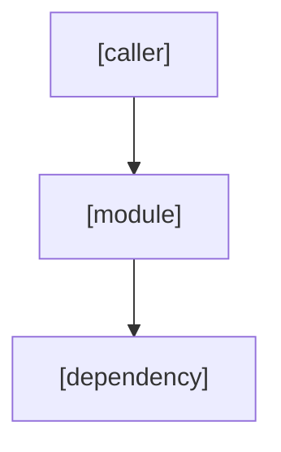
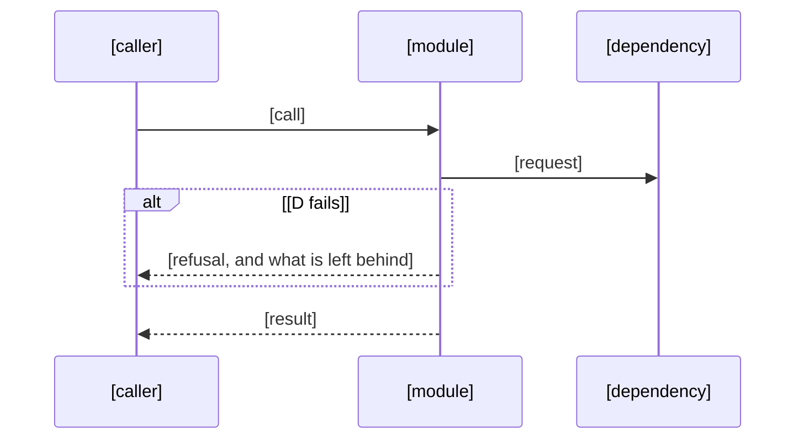

# Implementation Plan: [FEATURE]

**Spec**: `.agents/specs/<key>-<slug>/spec.md` · **Issue**: [KEY-n] · **Date**: [DATE]

## Summary

[The primary requirement and the technical approach, in a few lines]

## Key trade-off and research

<!-- The one choice that shapes the design, the option not taken and the cost of the one taken; then what was read
     before choosing. Worked example:
     - **Trade-off: exports stream row by row** instead of loading a table: memory stays flat; the cost is no
       total row count until the end.
     - **Research**: `src/export/command.ts` (stops on the first error), decision record 12 (no write lock during an export),
       the driver's cursor documentation. -->

- **Trade-off**: [the choice, the option not taken, and the cost of the one taken]
- **Research**: [the code, decision records, prior specs and outside work read before choosing, by path or link, and what each showed]

## Applicable standards

<!-- Every rule this plan must follow, and how it is enforced: a check (the test, lint rule or gate that fails) or
     "review" (a finding the reviewer raises). Worked example row:
     | Secrets by name only | check: the secret scanner in CI; review: the security reviewer | -->

| Rule                                | How it is enforced                                           |
| ----------------------------------- | ------------------------------------------------------------ |
| [rule, with its decision or source] | [check: the test, lint rule or gate / review: who raises it] |

<!-- For a feature or big spec plan.md is the design: the gate requires these nine sections in this order (write
"none" under one that does not apply). -->

## Architecture overview

[How the pieces fit]

<!-- A Mermaid diagram of the dependency direction (arrows point at what is imported). Add a sequence diagram where
     order or failure timing matters (a queue, a retry, a two-step write); delete it when nothing does. -->





## Components and responsibilities

[One line on how the work divides into the components below]

<!-- Keep the line above: the gate reads it as this section's body. Then one `###` per component this adds or changes,
     with its responsibility, location, the folder tree of every file it adds or changes, the real interface
     declarations in the repository's language (change the fence; names, parameters, returns, thrown errors), its
     behaviour (pseudocode for anything non-trivial) and its failure modes per dependency. A component without its
     folder tree or its interfaces is not done. Worked example:

     ### C1 Export streaming
     **Responsibility**: write a table as CSV row by row. **Location**: `src/export/`.
     ```text
     src/export/
     ├── stream.ts                 (new)
     └── __tests__/stream.test.ts  (new)
     ```
     ```ts
     /** @throws {ExportAbortedError} when the output closes before the last row */
     export function streamTable(table: string, out: Writable): Promise<{ rows: number; errors: number }>;
     ```
     **Behaviour**: open a cursor; for each row, write it or log an error line; close; return the counts.
     **Failure modes**: the database drops the cursor → abort, keep the partial file, report the last row written. -->

### C1 [Component name]

**Responsibility**: [what it owns, in one line] · **Location**: [module and folder]

```text
[folder]/
├── [path]/[file]           (new)
└── [path]/[file test]      (new)
```

```ts
/** [what it does] @throws [ErrorType] [when] */
export function [name]([param]: [Type]): [ReturnType];
```

**Behaviour**: [pseudocode for anything non-trivial, else one line]

**Failure modes**: [each dependency → what happens when it fails, and what is left behind]

## Files and folders

[The exact paths to add or change: the component trees above, merged]

## Data models and migrations

[Models, tables and migrations, or none]

## Contracts

[APIs, events and exports, or none]

## Error handling

[Failures, retries, and what a failure leaves behind]

## Security and tenancy

[Permissions, data isolation, personal data, secrets by name, or none]

## Testing strategy

[Which tests prove which acceptance criteria (AC-###)]

## Rollout

[Flags, migration order, release notes, or none]

## Partial-failure ordering

[The order the parts land and run in; what a failure between two steps leaves behind, and how it is undone; or none]

## Open questions

<!-- Approval waits until no question is open: answer each, move the answer into the spec or this plan, then
     write "None." -->

- [question, who answers it, and what it blocks]
